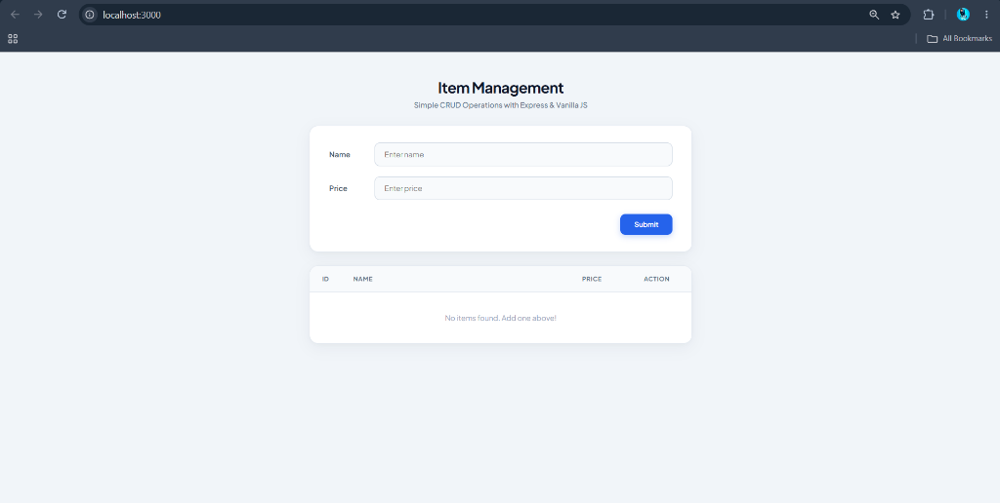
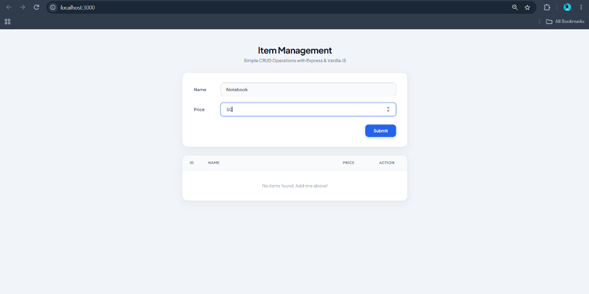
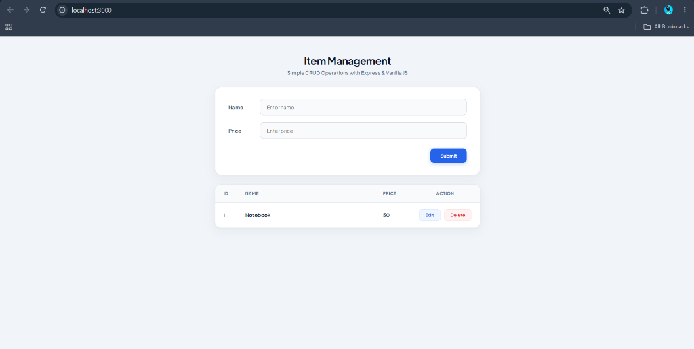
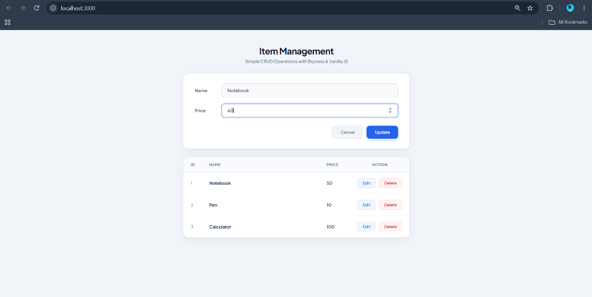
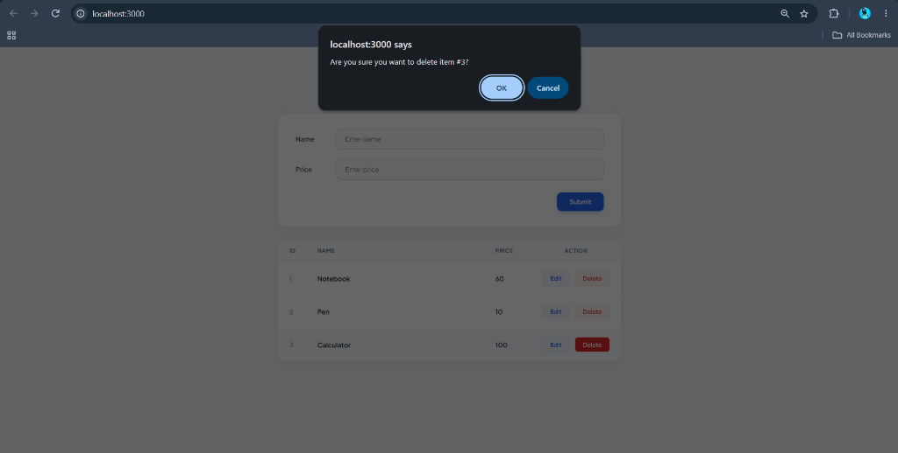

# MERN Lab Task 1: CRUD Operations with Express and Vanilla JS

A lightweight, modern full-stack web application that performs Create, Read, Update, and Delete (CRUD) operations on an array of items.

## 🚀 Features
* **Backend:** Node.js & Express REST API with in-memory array data storage.
* **Frontend:** Clean Vanilla JavaScript, HTML5, and modern responsive CSS.
* **Operations Supported:**
  * **Create:** Add new items with Name and Price.
  * **Read:** Display items in real-time in a structured data table.
  * **Update:** Click Edit to populate the form and update existing item values.
  * **Delete:** Remove items with confirmation prompt.

---

## 🛠️ Project Structure
```text
├── server.js              # Express backend server & REST API
├── package.json           # Node project manifest & dependencies
├── .gitignore             # Ignored directories (node_modules, etc.)
├── screenshots/           # Application output figures
│   ├── fig1_starting_phase.png
│   ├── fig2_while_adding_items.png
│   ├── fig3_items_added.png
│   ├── fig4_updating_items_price.png
│   └── fig5_deleting_items_from_list.png
└── public/
    ├── index.html         # Frontend layout
    ├── style.css          # Modern UI styling
    └── script.js          # Client-side fetch logic
```

---

## 📦 Getting Started

### 1. Clone the Repository
```bash
git clone https://github.com/adityapnaik03/Mern_Task_1.git
cd Mern_Task_1
```

### 2. Install Dependencies
```bash
npm install
```

### 3. Start the Server
```bash
node server.js
```

### 4. Open in Browser
Visit **http://localhost:3000** in your web browser.

---

## 📡 REST API Endpoints

| Method | Endpoint | Description |
| :--- | :--- | :--- |
| `GET` | `/items` | Fetch all items |
| `POST` | `/items` | Add a new item (`{ name, price }`) |
| `PUT` | `/items/:id` | Update an existing item by ID |
| `DELETE` | `/items/:id` | Remove an item by ID |

---

## 📸 Output Section

### Figure 1: Starting Phase
The initial state of the application on page load with the input form ready and the empty inventory table.


---

### Figure 2: While Adding Items
Entering a new item's details (`Name: Notebook`, `Price: 50`) into the form fields.


---

### Figure 3: Items Added
The item is successfully created via `POST /items` and dynamically rendered in the table starting with ID 1.


---

### Figure 4: Updating Item's Price
Clicking the "Edit" button populates the form with existing values; updating the price to `60` and submitting via `PUT /items/:id`.


---

### Figure 5: Deleting Items from List
Clicking the "Delete" button triggers a confirmation dialog before sending a `DELETE /items/:id` request to remove the item from the list.

